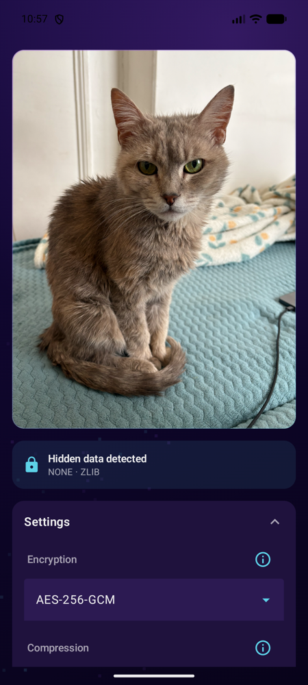
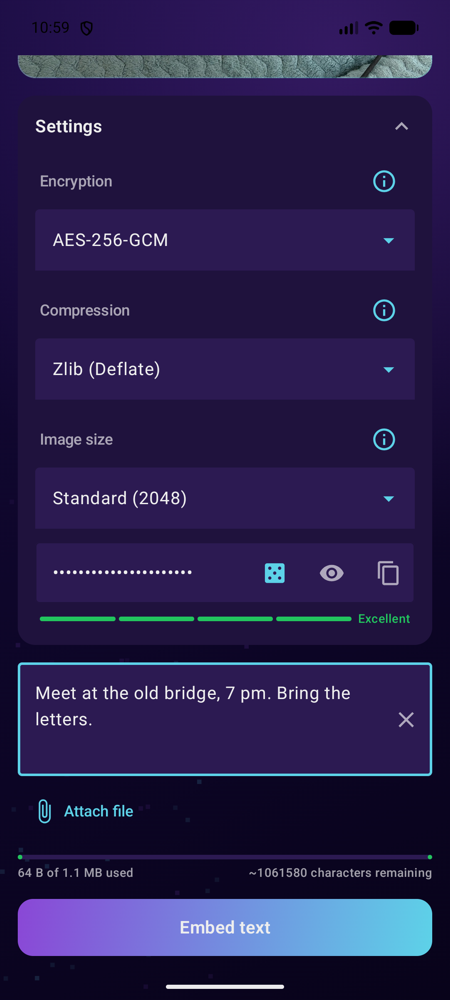
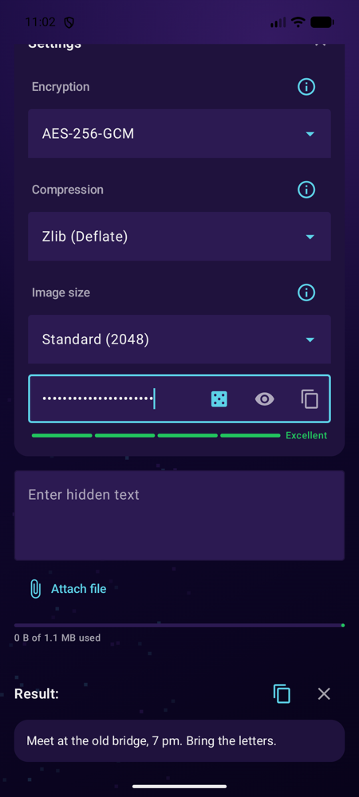

<p align="center">
  
</p>

<h1 align="center">Veilix</h1>

<p align="center">
  Hide an encrypted message or file inside an ordinary photo.<br>
  Offline, open source, with a documented format.
</p>

<p align="center">
  <a href="../../releases/latest"></a>
  <a href="../../actions/workflows/ci.yml"></a>
  
  <a href="LICENSE"></a>
</p>

<p align="center">
  
  &nbsp;
  
  &nbsp;
  
</p>

Veilix writes data into the lowest bit of the pixels of a photo. The picture
looks the same and opens anywhere, and with the password Veilix gets the data
back out. A password-protected image carries no magic bytes, header or length
field, so a program that doesn't have the password has nothing to recognise.

The app has no `INTERNET` permission. Nothing leaves the phone unless you share
it.

## Download

Get the APK from [**Releases**](../../releases/latest). It needs Android 10 or
newer.

Each release lists the SHA-256 of the APK. The signing certificate fingerprint
is:

```
SHA-256: <fill in after the first signed release>
```

To get updates automatically, add this repository to
[Obtainium](https://github.com/ImranR98/Obtainium).

## What it does

- Hides **text or any file** in a photo from the gallery, the camera or the file
  picker, and exports it as a PNG.
- Encrypts with **AES-256-GCM** or **ChaCha20-Poly1305**. The key comes from
  PBKDF2-HMAC-SHA256 with 600,000 rounds and a random salt for every image.
- Spreads the bits over **pseudo-random pixel positions** chosen by the
  password, and changes pixels with **LSB matching** (±1) rather than
  overwriting the bit, which defeats the classic histogram attacks.
- Leaves **no readable marker**. Without the password, Veilix itself reports
  "nothing found" the same way for a clean photo and for one with hidden data.
- **Survives messengers.** They recompress photos and wipe hidden data, so
  Veilix can wrap the PNG in a ZIP, which messengers deliver untouched. Veilix
  opens the ZIP directly.
- **Checks every export.** After writing the PNG, Veilix reads it back and
  compares every carrier bit before offering it to you.
- **Has an open mode too.** Without a password Veilix writes a format with a
  visible marker that anyone with Veilix can read. Use it for things that aren't
  secret.
- **Reads images from iOS.** A separate iOS app implements the same format, and
  images go both ways.
- Smaller things: images are named like camera shots (`IMG_1234.png`), the
  screen is hidden in recent apps, copied secrets clear from the clipboard after
  a minute, repeated wrong passwords trigger a growing lockout, and the
  interface is in English, Russian and Serbian.

## How it works

```
password ──PBKDF2 (600k)──► master ──HKDF──┬─► meta key       (sealed 7-byte header)
   salt (16 random bytes) ─┘               ├─► body key       (your data)
                                           └─► positions key  (AES-CTR stream → which pixels)
```

1. The salt sits at positions anyone can find, because the decoder needs it
   before it has a key.
2. Every other position comes from an AES-CTR keystream under the positions
   key. Without the password you don't know which pixels to read.
3. A 7-byte header (version, cipher, compression, length) is sealed with
   AES-GCM. If its tag doesn't verify, the password is wrong.
4. The body is compressed, encrypted with authentication, and bound to the salt
   and header as associated data.

The full byte-level description is in **[docs/FORMAT.md](docs/FORMAT.md)**, with
[test vectors](test-vectors) you can check another implementation against.

## What it does not protect against

Please read this before you rely on Veilix.

- **Statistical steganalysis.** LSB matching beats simple detectors, but modern
  detectors (rich models, CNNs) can tell that an image was modified, especially
  when the payload fills much of its capacity. Veilix hides what the data says
  and where it is. It does not guarantee that nobody can tell something is
  hidden. Small messages in large photos are the hardest to spot.
- **A weak password.** Anyone can extract the salt and run an offline guessing
  attack. PBKDF2 slows that down but can't make a short password safe. The
  in-app lockout only applies inside Veilix.
- **Recompression, resizing or editing.** Any lossy step destroys the payload.
  Send the PNG as a file or as a ZIP.
- **A compromised phone.** Malware or anyone with access to your unlocked device
  can see what you type.
- **Comparison with the original.** If someone has both the original photo and
  the Veilix image, the difference shows. Use a photo you haven't published.

Veilix has not had an independent security audit.

## Building

You need JDK 17 or newer and the Android SDK (Android Studio installs both).

```bash
./gradlew testDebugUnitTest   # unit tests, including the iOS test vectors
./gradlew assembleDebug       # app/build/outputs/apk/debug/app-debug.apk
```

A release build is signed when it finds `keystore.properties` in the project
root:

```properties
storeFile=veilix-release.jks
storePassword=…
keyAlias=veilix
keyPassword=…
```

Without the file the release APK is built unsigned. CI reads the same values
from environment variables (see [RELEASING.md](RELEASING.md)).

## Project layout

```
app/src/main/java/cattivole/veilix/
├── core/          format, crypto, steganography (no Android UI dependencies)
│   ├── stego/         position streams, v4 writer and reader, capacity
│   ├── crypto/        PBKDF2, HKDF, AEAD
│   ├── format/        envelope, v1–v3 header, ZIP transport
│   └── compression/
├── ui/            Jetpack Compose screens and view model
└── data/          settings and lockout state
docs/FORMAT.md     format specification
test-vectors/      images written by the iOS app, used by the unit tests
```

## Known limitations

- Android can't decompress **LZFSE** or **LZMA** yet. The iOS app offers both,
  so a message compressed with them on iOS shows "unsupported algorithm" here.
  DEFLATE and no compression work in both directions.
- PNG output only. JPEG can't carry LSB data.
- A payload can use at most about 0.9 bits per colour channel, which is about
  4 MB in a 12-megapixel photo kept at its original size. The app shows how much space is
  left.

## Contributing

Issues and pull requests are welcome, see [CONTRIBUTING.md](CONTRIBUTING.md). If
you find a security problem, follow [SECURITY.md](SECURITY.md) instead of opening
a public issue.

## License

[GPL-3.0](LICENSE). Forks and derived apps must stay open source under the same
terms.
